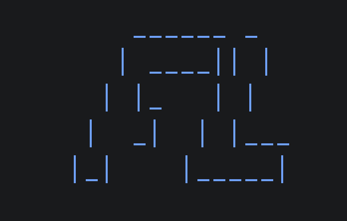
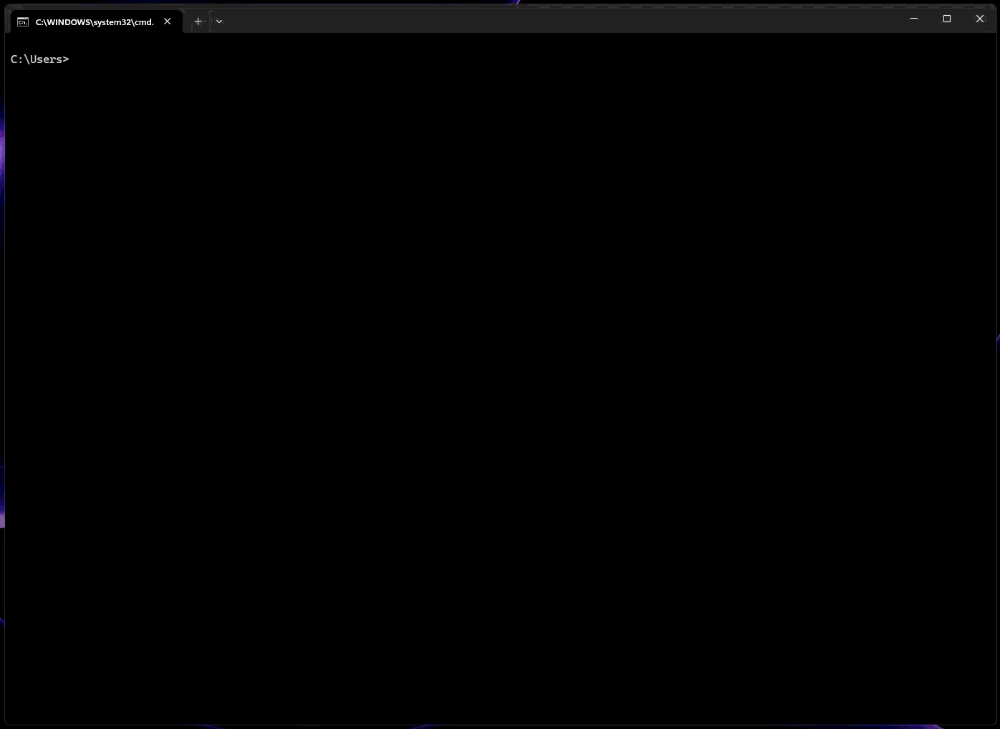
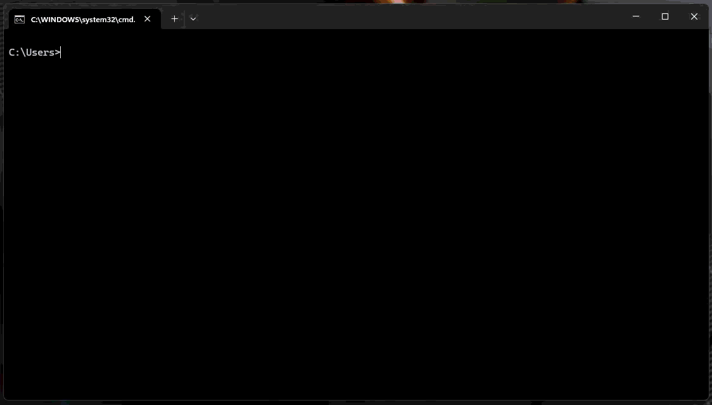
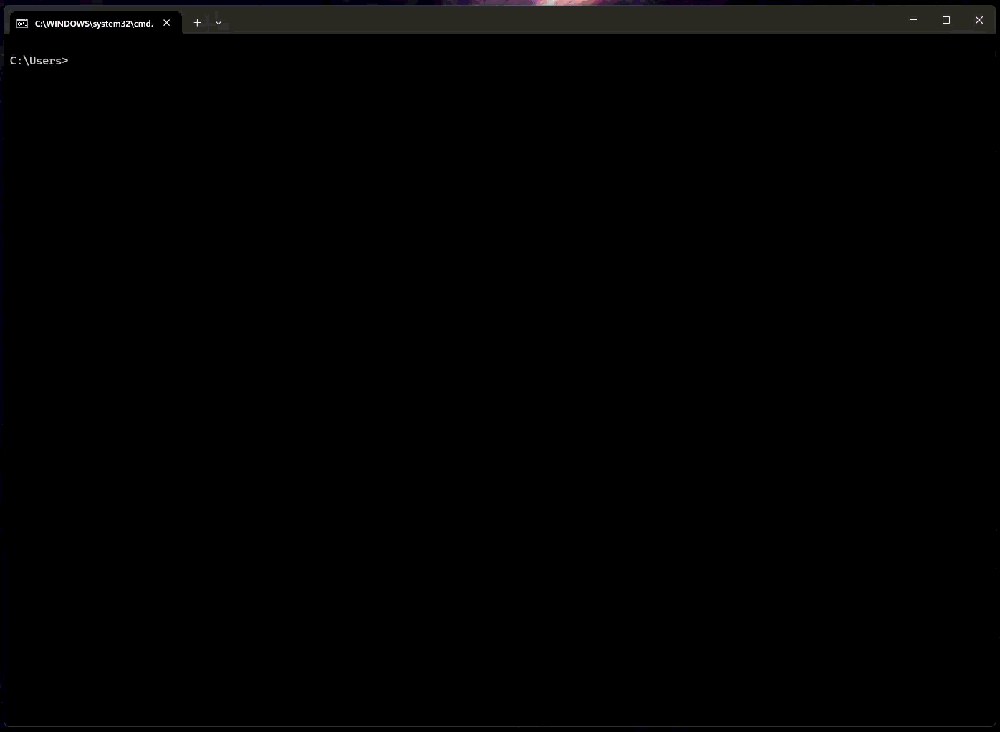

# FluentLang

  

  <h1>FluentLang</h1>
  
AI-powered sentence analysis from your terminal.

    

  
  
  
  
  
    

---

## Overview

**FluentLang** is a CLI application designed to provide quick and convenient way to understand a sentence. It allows you
to see explanation for AI provide about your sentence in a convenient way.

---

## Tech Stack

| Technology                                        | Version  | Description                                                                                             |
|:--------------------------------------------------|:---------|:--------------------------------------------------------------------------------------------------------|
| **[Rust](https://rust-lang.org/)**                | `1.98.1` | The main language for a development                                                                     |
| **[clap](https://crates.io/crates/clap)**         | `4.6.6`  | A simple to use, efficient, and full-featured Command Line Argument Parser                              |
| **[termimad](https://crates.io/crates/termimad)** | `0.35.5` | Markdown Renderer for the Terminal                                                                      |
| **[rstest](https://crates.io/crates/rstest)**     | `0.28.0` | Rust fixture based test framework. It use procedural macro to implement fixtures and table based tests. |
| **[reqwest](https://crates.io/crates/reqwest)**   | `0.13.5` | higher level HTTP client library                                                                        |

---

## Installation

1. Go to the [**Releases**](../../releases) section.
2. Download the rar archive for your OS.
3. Extract the archive to a convenient location.
4. Run this command in the PowerShell `.\install.ps1` to install for Windows and `./install.sh` for Linux / macOS.

---

## Uninstallation

Just run in the PowerShell `.\uninstall.ps1` to uninstall for Windows and `./uninstall.sh` for Linux / macOS.

---

## Usage

### 1. Getting Started

Upon first request, you need to add private key from the AI providers. This application provides such providers:

- [Groq Cloud](https://console.groq.com/home)
- [Google AI Studio](https://aistudio.google.com/prompts/new_chat)
- [Open Router](https://openrouter.ai/)

To add private key you need to use this command `fluentlang config set groq-cloud.private_key "PRIVATE_KEY"` (for the
following examples we'll use Groq Cloud). After this you need to set current provider to send requests. To set it you
need to use this command `fluentlang config default groq-cloud`.

To see all config information you can use this command `fluentlang config`

You can use flag `--help` to see the command explanation or help. For example:
`fluentlang config --help`

### 2. Making request

After you set up the config data you can make request to see your sentence explanation. To send request you have to use
this command `fluentlang sentence "YOUR_SENTENCE"`

